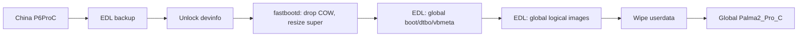

# Boox P6 Pro 小彩马 (China) → Palma 2 Pro (Global)

Field notes from converting a Chinese-market **Boox P6 Pro 小彩马** (`P6ProC`, Android 13)
to the global **Palma 2 Pro** (`Palma2_Pro_C`, Android 15 system over an Android 11
vendor) firmware.

> [!WARNING]
> **Experimental, single-device report.** This is not supported by Onyx. It requires
> unlocking the bootloader, which permanently affects verified boot, Play Integrity and
> DRM. You can lose data or hard-brick the device. Read
> [docs/08-risks.md](docs/08-risks.md) before touching anything.
>
> No proprietary binaries are distributed here. Firmware, boot images, loaders,
> partition dumps and keys are not included.

## Result

| | China stock | Global after conversion |
|---|---|---|
| Product | `P6ProC` | `Palma2_Pro_C` |
| System | Android 13, BOOX 4.2.3 | Android 15, BOOX 4.2 (build 3316) |
| Vendor | Android 11, VNDK 30 | Android 11, VNDK 30 |
| SoC | SM7225 (Snapdragon 750G) | same |
| Play Store | absent from the launcher | preinstalled system app |
| GMS core | present | present |
| Bootloader | locked | unlocked (`verifiedbootstate=orange`) |
| Play certification | — | registration attempted, not confirmed |
| Play Integrity / Widevine | — | fails / not provisioned |
| OTA | China server | global `Palma2_Pro_C` fingerprint (4.2; 4.3 not yet released) |

Working: display, touch, front light, Wi-Fi, Bluetooth, Google account, Play Store,
Gemini (including the assistant overlay), battery, root (optional).

Not verified: SIM data/calls, camera, stylus, GPS, sensors, OTA installation, Play
certification status after registration.

## TL;DR 流程（中文）

1. **取官方包**：用 OTA 接口按精确 `ro.vendor.build.onyxfp` 指纹查询，下载并校验
   `update.upx`。
2. **解密/解包**：`DeBooxUpx.py` + `extract_android_ota_payload` 得到 14 个分区镜像。
3. **解锁**：EDL 刷 Fairphone 4 ABL → 打开 OEM 解锁 → 改 `devinfo` 两个字节 → 恢复出厂。
4. **扩容 super**：fastbootd 删除 COW 快照，把逻辑分区 resize 到全球版尺寸。
5. **EDL 写入**：物理分区用 `edl w`，逻辑分区按 extent 分块 `edl ws`；擦除
   `userdata`/`metadata`/`misc`；首次启动。
6. **可选 root**：Magisk 修补全球版 `boot`，EDL 刷回 `boot_a`。
7. **回滚**：写回原厂 `boot`/`abl`/`devinfo` 和国行镜像，恢复出厂。

## Process

## Repository layout

| Path | Contents |
|---|---|
| `docs/00-device-identity.md` | Why the two models are comparable |
| `docs/01-firmware-acquisition.md` | OTA API, fingerprint format, decrypt/extract |
| `docs/02-unlock-root.md` | EDL, `devinfo`, FP4 ABL, Magisk |
| `docs/03-partition-map.md` | Partition-by-partition comparison |
| `docs/04-super-resize.md` | COW removal and logical partition resize |
| `docs/05-edl-flash.md` | Sector math, physical vs logical flashing |
| `docs/06-first-boot.md` | First boot, Play/GMS, assistant, quirks |
| `docs/07-restore.md` | Back to fresh global, or back to China |
| `docs/08-risks.md` | What is not solved |
| `scripts/` | OTA query, parallel downloader, chunked logical flasher |

## Hard requirements

- EDL access (`adb reboot edl`; Qualcomm 9008) and a working Firehose loader for
  SM7225/UFS. Without EDL there is no recovery.
- A full backup of device-unique partitions (`persist`, `modemst1/2`, `fsg`, `fsc`,
  `devinfo`, `frp`, `misc`) — these carry IMEI/calibration and are not in any OTA.
- The official firmware packages for **both** models.
- Enough disk space (~7 GB per extracted package).

## Credits

Prior work this builds on:

- [Kisuke-CZE/Palma_2_Pro-tips](https://github.com/Kisuke-CZE/Palma_2_Pro-tips) — Palma 2
  Pro root and EDL loader.
- [dynamicfire/boox-p6pro-root](https://github.com/dynamicfire/boox-p6pro-root) — P6 Pro
  (China) root on firmware 4.1.x.
- [Renate / temblast.com EDL notes](https://www.temblast.com/edl.htm) — Qualcomm EDL.
- [spavikevik/palma2pro-eos](https://github.com/spavikevik/palma2pro-eos) — global
  `Palma2_Pro_C` device tree and recon; confirmed the vendor/API split.
- [Hagb/decryptBooxUpdateUpx](https://github.com/Hagb/decryptBooxUpdateUpx) — `.upx`
  decryption and key database.
- [cyxx/extract_android_ota_payload](https://github.com/cyxx/extract_android_ota_payload)
  — payload extraction.
- [timschneeb/OnyxTweaks](https://github.com/timschneeb/OnyxTweaks) and
  [l-althueser/OnyxMMKVEditor](https://github.com/l-althueser/OnyxMMKVEditor) — Onyx
  launcher/config research.
- [bkerler/edl](https://github.com/bkerler/edl) — host-side EDL client.

## License

The documentation and scripts in this repository are MIT licensed. Onyx firmware,
Google apps and Qualcomm loaders remain the property of their owners and are not
redistributed here.
